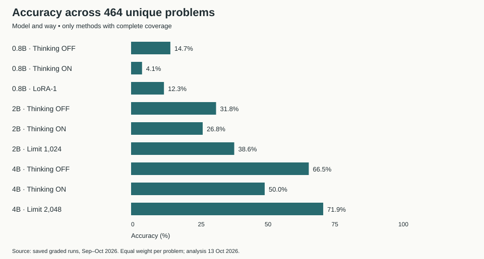
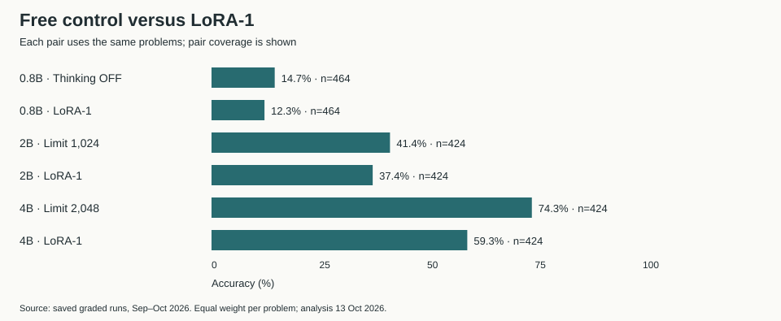
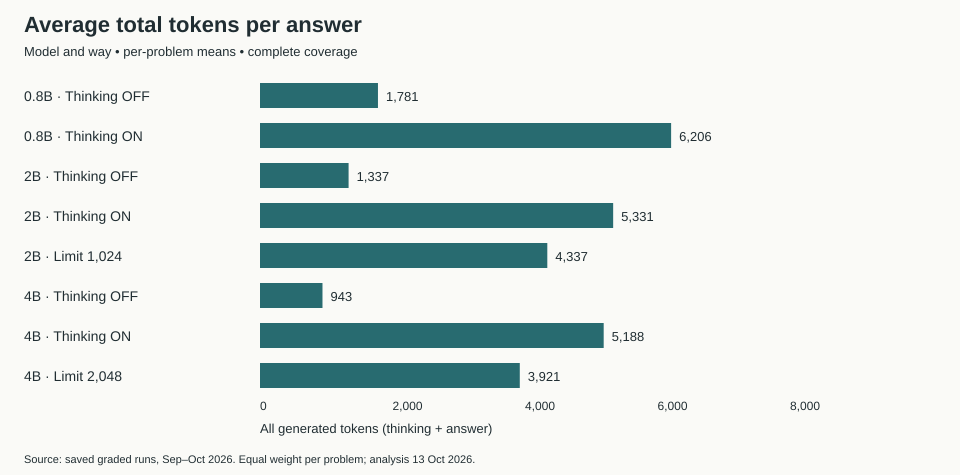

# The combined results

**464 unique problems** form the main results view.
Accuracy gives each problem equal weight, using all its available attempts.

**0.8B: Thinking OFF 14.7%** · **2B: Limit 1,024 38.6%** · **4B: Limit 2,048 71.9%**

These are the best observed controls among methods covering the full set.
A higher score on an incomplete subset does not establish a better method.

## Methods with complete coverage

| Model | Way | Accuracy | 95% interval | Coverage | Attempts |
|---|---|---|---|---|---|
| 0.8B | Thinking OFF | 14.7% | [11.6%, 17.9%] | 464/464 | 464 |
| 0.8B | Thinking ON | 4.1% | [2.4%, 6.0%] | 464/464 | 464 |
| 0.8B | LoRA-1 | 12.3% | [9.3%, 15.3%] | 464/464 | 464 |
| 2B | Thinking OFF | 31.8% | [27.7%, 36.0%] | 464/464 | 738 |
| 2B | Thinking ON | 26.8% | [23.2%, 30.6%] | 464/464 | 738 |
| 2B | Limit 1,024 | 38.6% | [34.4%, 42.8%] | 464/464 | 738 |
| 2B | LoRA-1 | 34.4% | [30.3%, 38.4%] | 464/464 | 698 |
| 4B | Thinking OFF | 66.5% | [62.3%, 70.5%] | 464/464 | 738 |
| 4B | Thinking ON | 50.0% | [45.9%, 54.3%] | 464/464 | 738 |
| 4B | Limit 2,048 | 71.9% | [67.9%, 75.6%] | 464/464 | 738 |
| 4B | LoRA-1 | 56.8% | [52.5%, 61.0%] | 464/464 | 698 |

## Training versus free controls on shared problems

| Model | Free control | Shared problems | Free accuracy | LoRA-1 accuracy | Gap (points) | 95% gap interval |
|---|---|---|---|---|---|---|
| 0.8B | Thinking OFF | 464 | 14.7% | 12.3% | +2.4 | [-0.4, +5.2] |
| 2B | Limit 1,024 | 464 | 38.6% | 34.4% | +4.2 | [+0.8, +7.8] |
| 4B | Limit 2,048 | 464 | 71.9% | 56.8% | +15.1 | [+11.3, +19.0] |

The 0.8B free control's lead is uncertain: its interval includes zero.
The 2B interval is narrowly positive, and the 4B interval is positive.
These intervals are descriptive and unadjusted for selecting comparisons after results.
Do not describe these as universal or definitive wins.

## All available methods, with coverage

Coverage means unique problems with results. A missing result is not counted as a failure. Only compare scores directly when they use the same problems.

| Model | Way | Accuracy | Coverage | Attempts |
|---|---|---|---|---|
| 0.8B | Limit 1,024 | 11.3% | 274/464 | 274 |
| 0.8B | Limit 512 | 10.6% | 464/464 | 464 |
| 0.8B | LoRA-1 | 12.3% | 464/464 | 464 |
| 0.8B | Thinking OFF | 14.7% | 464/464 | 464 |
| 0.8B | Thinking ON | 4.1% | 464/464 | 464 |
| 2B | Think briefly | 6.4% | 274/464 | 548 |
| 2B | Limit 1,024 | 38.6% | 464/464 | 738 |
| 2B | Limit 2,048 | 40.9% | 274/464 | 274 |
| 2B | Limit 512 | 39.4% | 274/464 | 548 |
| 2B | LoRA-1 | 34.4% | 464/464 | 698 |
| 2B | LoRA-2 | 45.1% | 234/464 | 468 |
| 2B | Thinking OFF | 31.8% | 464/464 | 738 |
| 2B | Thinking ON | 26.8% | 464/464 | 738 |
| 4B | Limit 1,024 | 76.5% | 234/464 | 468 |
| 4B | Limit 2,048 | 71.9% | 464/464 | 738 |
| 4B | Limit 4,096 | 76.7% | 234/464 | 468 |
| 4B | Limit 512 | 75.4% | 234/464 | 468 |
| 4B | LoRA-1 | 56.8% | 464/464 | 698 |
| 4B | Thinking OFF | 66.5% | 464/464 | 738 |
| 4B | Thinking ON | 50.0% | 464/464 | 738 |

For example, 2B Limit 2,048 covers only 274 problems.
Its score cannot be ranked directly against Limit 1,024 on 464 problems.
LoRA-2 covers only its original 234 problems; it is not a full-study result.

## Paired comparisons

Positive gaps favor the first method. Every row uses identical shared problem IDs.

| Model | Way vs reference | Shared problems | Way accuracy | Reference accuracy | Gap (points) | 95% gap interval |
|---|---|---|---|---|---|---|
| 0.8B | Thinking OFF vs Thinking ON | 464 | 14.7% | 4.1% | +10.6 | [+7.5, +13.8] |
| 0.8B | Thinking OFF vs LoRA-1 | 464 | 14.7% | 12.3% | +2.4 | [-0.4, +5.2] |
| 2B | Limit 1,024 vs Thinking ON | 464 | 38.6% | 26.8% | +11.7 | [+8.5, +15.1] |
| 2B | Limit 1,024 vs LoRA-1 | 464 | 38.6% | 34.4% | +4.2 | [+0.8, +7.8] |
| 2B | Limit 1,024 vs Thinking OFF | 464 | 38.6% | 31.8% | +6.8 | [+3.2, +10.5] |
| 4B | Limit 2,048 vs Thinking ON | 464 | 71.9% | 50.0% | +21.9 | [+18.3, +25.5] |
| 4B | Limit 2,048 vs LoRA-1 | 464 | 71.9% | 56.8% | +15.1 | [+11.3, +19.0] |
| 4B | Limit 2,048 vs Thinking OFF | 464 | 71.9% | 66.5% | +5.4 | [+1.6, +9.1] |

## Tokens and output caps

A token is a small piece of text. These are averages of per-problem means.
All tokens include both thinking and the final answer.
“Hit output cap” comes from the saved flag; it is not a loop detector or the pass/fail rule.
Token counts describe output length, not measured GPU time.

| Model | Way | Coverage | Thinking tokens | All tokens | Hit output cap |
|---|---|---|---|---|---|
| 0.8B | LoRA-1 | 464/464 | 5,150 | 5,256 | 68.1% |
| 0.8B | Thinking OFF | 464/464 | 0 | 1,781 | 19.0% |
| 0.8B | Thinking ON | 464/464 | 6,147 | 6,206 | 86.4% |
| 2B | Limit 1,024 | 464/464 | 923 | 4,337 | 45.3% |
| 2B | LoRA-1 | 464/464 | 4,414 | 4,735 | 52.6% |
| 2B | Thinking OFF | 464/464 | 0 | 1,337 | 12.4% |
| 2B | Thinking ON | 464/464 | 5,169 | 5,331 | 60.6% |
| 4B | Limit 2,048 | 464/464 | 1,603 | 3,921 | 29.2% |
| 4B | LoRA-1 | 464/464 | 4,661 | 4,797 | 38.5% |
| 4B | Thinking OFF | 464/464 | 0 | 943 | 5.3% |
| 4B | Thinking ON | 464/464 | 5,064 | 5,188 | 45.7% |

## Full-coverage recommended controls by problem group

| Model | Way | Problem group | Coverage | Accuracy |
|---|---|---|---|---|
| 0.8B | Thinking OFF | HumanEval+ easy | 164 | 25.6% |
| 0.8B | Thinking OFF | LiveCodeBench easy | 166 | 15.7% |
| 0.8B | Thinking OFF | LiveCodeBench medium | 134 | 0.0% |
| 2B | Limit 1,024 | HumanEval+ easy | 164 | 60.4% |
| 2B | Limit 1,024 | LiveCodeBench easy | 166 | 43.4% |
| 2B | Limit 1,024 | LiveCodeBench medium | 134 | 6.0% |
| 4B | Limit 2,048 | HumanEval+ easy | 164 | 86.9% |
| 4B | Limit 2,048 | LiveCodeBench easy | 166 | 85.2% |
| 4B | Limit 2,048 | LiveCodeBench medium | 134 | 36.9% |

Different difficulty mixes change the overall score. Report these groups alongside the headline.

## Earlier focused checks

LoRA-2's original 234-problem experiment reported a thinking-length ratio of x1.00
and 45.1% accuracy. These were not rerun on all 464 problems.
The earlier MBPP+ pilot used 100 separate test problems. It is excluded here.
Its 65% LoRA accuracy versus 50% thinking ON is an earlier transfer check, not a combined score.
Loop and longer-output checks retain their original coverage in [the explanation](06-why-it-works.md).

Source: [combined results](../results/combined/README.md), calculated from saved graded answers. No model was run again.

## Completed extension: 2B LoRA-1 + limit 1,024

**41.2% accuracy — 191/464 passed. Coverage: 464/464, one attempt per problem.**
This uses Qwen3.5-2B and the existing LoRA-1 trained add-on.

The missing40 LoRA-alone runs are complete: 2B passed 1/40; 4B passed 12/40.
Their all-attempt, equal-problem-weight scores now cover all 464:
**2B LoRA-1 alone 34.4%; 4B LoRA-1 alone 56.8%.**

On the same 464 first attempts, the 2B comparison is:
**LoRA + limit 41.2% (191/464), LoRA alone 34.9% (162/464), OFF 32.5% (151/464).**
The combination gains 6.2 points over LoRA alone, interval +2.4 to +10.1.
It gains 8.6 points over OFF, interval +4.5 to +12.9.
LoRA alone's 2.4-point lead over OFF is inconclusive: interval −1.7 to +6.7.
The combination uses 13.4% fewer output tokens than LoRA alone.
OFF uses 66.5% fewer output tokens than the combination.

Limit alone remains 38.6% (179/464). The combination gains 2.6 points,
interval −1.5 to +6.7. A reliable gain over the free limit is not established.

Earlier tables use all attempts per problem; 2B LoRA alone is 34.4% under that rule.
The 34.9% reference above uses first attempts, matching the combination's one attempt.
Archived 424-problem reports retain their original numbers as history.
The extension is retrospective, with historical references and unadjusted intervals.
No result proves a universal winner. Other incomplete methods retain their coverage.

Checked 14 October 2026. Source: [completed result](../results/lora-limit-2b/README.md).
Updated comparison: [missing40 results](../results/lora-missing40/README.md).
