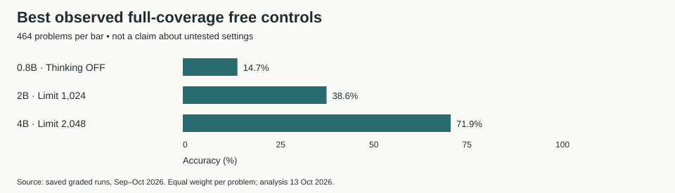
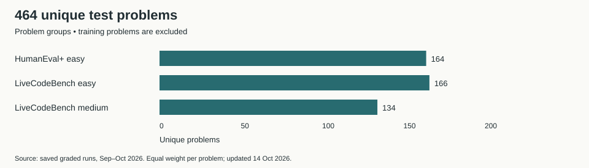
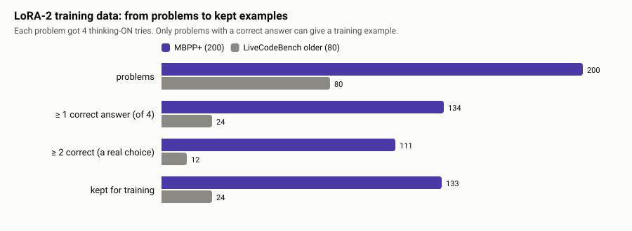
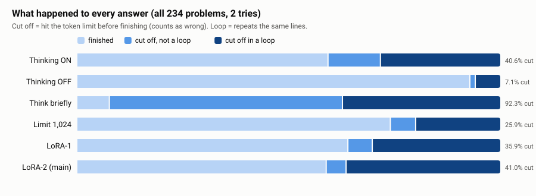

# Stop Overthinking, Keep Passing the Tests

Teacher and paper draft: **464 unique code problems**, with explicit method coverage.

# The thesis in one page

We studied **464 unique code problems** using three small Qwen3.5 models.
The question: does training the model to think shorter beat free thinking controls?
A *LoRA* is a small trained add-on. A *token* is a small piece of text.

**0.8B: Thinking OFF 14.7%** · **2B: Limit 1,024 38.6%** · **4B: Limit 2,048 71.9%**

These are the best observed free controls with **464/464 coverage**.
“Free” means no additional training; generating answers still uses compute.



## What training added

| Model | Free control | Shared problems | Free accuracy | LoRA-1 accuracy | Gap (points) | 95% gap interval |
|---|---|---|---|---|---|---|
| 0.8B | Thinking OFF | 464 | 14.7% | 12.3% | +2.4 | [-0.4, +5.2] |
| 2B | Limit 1,024 | 424 | 41.4% | 37.4% | +4.0 | [+0.1, +7.8] |
| 4B | Limit 2,048 | 424 | 74.3% | 59.3% | +15.0 | [+11.2, +18.8] |


In the earlier all-attempt analysis, all three free controls score higher than LoRA-1 alone on shared problems.
The 0.8B interval crosses zero, so its small lead is uncertain.
The 2B lead has an interval only just above zero. The 4B lead is clearer.
These are retrospective, unadjusted comparisons, not proof of a universal winner.

## How to read the result

Each problem gets equal weight, whether it has one attempt or two.
For each problem, average its pass/fail results. Then average across problems.
2B and 4B LoRA-1 cover 424/464 problems. Do not treat missing results as wrong answers.
Earlier LoRA-2 and loop checks cover only 234 problems.

The combined view was chosen after the runs. It was not a single preselected exam.
Collection details stay in the methods note; the main story uses all 464 problems.

Source: [combined results](../results/combined/README.md), calculated from saved graded answers. No model was run again.

## Completed extension: 2B LoRA-1 + limit 1,024

**41.2% accuracy — 191/464 passed. Coverage: 464/464, one attempt per problem.**
This uses Qwen3.5-2B and the existing LoRA-1 trained add-on.

On the same 464 first attempts, limit alone scores 38.6% (179/464).
The combination gains 2.6 points and uses 6.4% fewer total output tokens.
The 95% gap interval is −1.5 to +6.7 points. A reliable gain is not established.
On the 424 shared first attempts, the combination scores 43.9%, versus LoRA-1 alone at 38.0%.
That gain is 5.9 points, with an interval of +1.4 to +10.4.

Earlier tables use all attempts per problem; LoRA-1 alone is 37.4% under that rule.
Do not confuse that number with the 38.0% first-attempt reference.
The extension is retrospective, with historical references and unadjusted intervals.
It does not prove training universally beats free controls.

2B and 4B LoRA-1 alone still each miss the same extra 40 problems.
Only these two gaps are planned next: 80 new answers, no training or completed-run repeats.
Other partial methods retain their stated coverage.

Checked 14 October 2026. Source: [completed result](../results/lora-limit-2b/README.md).
Next: [missing-40 plan](../results/lora-missing40/PLAN.md).


---

# How we did it

We combined saved graded results for **464 unique problems**.
No new answers were generated. No training was run.
This update spends no Colab units.

## What changes between methods

- Thinking OFF: answer without thinking notes.
- Thinking ON: allow notes until the overall output cap.
- Thinking limit: end the notes at a fixed token budget, then generate the answer.
- Think briefly: ask for shorter notes in the prompt.
- LoRA-1: use a small add-on trained on shortest correct answers.
- LoRA-2: use the original 2B study's larger training set; coverage is 234/464.

A token is a small piece of text. LoRA trains an add-on while keeping the base model fixed.
The reported limits refer to thinking tokens, not the whole answer.
The original output caps were 4,096 for HumanEval+ and 8,192 for LiveCodeBench.
The saved runs used temperature 0.6, top-p 0.95, and top-k 20.
Repeat stopping was used in the size extensions; 2B retained its original handling.
This is a summary of existing runs, not a newly standardized experiment.

## How accuracy is calculated

For each problem, count the share of its attempts that passed.
Then average those shares across covered problems.

```text
Problem A: 1 pass from 2 attempts → 0.5
Problem B: 1 pass from 1 attempt  → 1.0
Combined accuracy: (0.5 + 1.0) / 2 = 75%
```

Pooling the three attempts would give 66.7%. That would give A twice the weight.
Our combined score gives each problem equal weight.
We do not average rounded percentages from the old summaries.

Coverage means unique problems with results. A missing result is not counted as a failure. Only compare scores directly when they use the same problems.

## Tests and uncertainty

An answer passes when it passes every test actually used by the saved grader.
HumanEval+ used its extended tests. LiveCodeBench used up to 20 tests per problem.
Thus these results do not establish success on every available LiveCodeBench hidden test.
Generated code was checked in a separate process with time limits.
This update reads scores only; it does not execute generated code.

For a comparison, use the intersection of both methods' problem IDs.
Resample whole problems 2,000 times with seed 3407.
The reported 95% intervals are percentile bootstrap intervals.
Both methods remain paired on each sampled problem; attempts are not independent problems.
Intervals reflect variation across problems, not all training or generation randomness.
They are unadjusted for multiple comparisons and post-result method selection.

## A retrospective combined view

The 464 problems came from several runs with different attempt counts.
The original 234 were selected before their results; later collections added 40 and 190.
We chose to combine them on 13 October 2026, after seeing results.
This history matters for interpreting claims, but it does not prevent a labelled combined summary.
Raw files and the original formal thesis remain unchanged.

Source: [combined results](../results/combined/README.md), calculated from saved graded answers. No model was run again.

## Completed extension: 2B LoRA-1 + limit 1,024

**41.2% accuracy — 191/464 passed. Coverage: 464/464, one attempt per problem.**
This uses Qwen3.5-2B and the existing LoRA-1 trained add-on.

On the same 464 first attempts, limit alone scores 38.6% (179/464).
The combination gains 2.6 points and uses 6.4% fewer total output tokens.
The 95% gap interval is −1.5 to +6.7 points. A reliable gain is not established.
On the 424 shared first attempts, the combination scores 43.9%, versus LoRA-1 alone at 38.0%.
That gain is 5.9 points, with an interval of +1.4 to +10.4.

Earlier tables use all attempts per problem; LoRA-1 alone is 37.4% under that rule.
Do not confuse that number with the 38.0% first-attempt reference.
The extension is retrospective, with historical references and unadjusted intervals.
It does not prove training universally beats free controls.

2B and 4B LoRA-1 alone still each miss the same extra 40 problems.
Only these two gaps are planned next: 80 new answers, no training or completed-run repeats.
Other partial methods retain their stated coverage.

Checked 14 October 2026. Source: [completed result](../results/lora-limit-2b/README.md).
Next: [missing-40 plan](../results/lora-missing40/PLAN.md).


---

# The datasets, and how we checked them

The combined study has **464 distinct test problems**.
Training problems are not part of this total.



| Dataset and difficulty | Problems |
|---|---|
| HumanEval+ easy functions | 164 |
| LiveCodeBench easy | 166 |
| LiveCodeBench medium | 134 |
| Total | 464 |


HumanEval+ asks for Python functions. LiveCodeBench includes contest programs and class methods.
There are no hard problems in this study.
We checked IDs across all collection lists and found no duplicate test problems.
The combined total is 164 function problems and 300 contest problems.

## The training set

Training problems are **not** the test problems.
LoRA-1 used a pool of **100** easy functions.
LoRA-2 used the bigger pool below.

| Pool | Problems | Why this pool |
|---|---|---|
| MBPP+ | 200 | Easy Python functions with strong tests. The early test showed they work. |
| Older LiveCodeBench | 80 (40 easy + 40 medium) | Older contest training problems from release v1. Distinct IDs were checked against the combined test set; dates alone do not establish separation. |

```text
200 MBPP+  +  80 older LiveCodeBench  =  280 problems
        │
        ▼
4 thinking-ON tries each
        │
        ▼
keep the shortest correct answer
(never shorter than half the middle correct length)
        │
        ▼
157 training examples  →  LoRA-2
133 from MBPP+   +   24 from older LiveCodeBench
```



| | MBPP+ | Older LiveCodeBench |
|---|---|---|
| Problems | 200 | 80 |
| Answers (4 tries) | 800 | 320 |
| Correct answers | 357 (44.6%) | 44 (13.8%) |
| Kept examples | 133 | 24 |
| Middle thinking length of kept examples | 515 tokens | **4,709 tokens** |

The LiveCodeBench training examples were already long.
There was almost nothing short to learn there.
The kept length divided by the average correct length was **0.83** on MBPP+ and **0.99** on older LiveCodeBench.

LoRA-2 trained on those 157 examples for 3 passes.
That took about 6 minutes.
The loss fell from about 0.25 to about 0.16, so the add-on did learn the examples.
The later chapter explains why that still did not shorten test thinking.

## Overlap and limitations

The combined audit compares all 464 test IDs with **280 saved training-pool IDs**.
Exact ID overlap is **zero**. It also checks IDs in saved training-answer and retained-example files.
The source list is in [the audit](../results/combined/results.json).
This update does not repeat a full text-similarity audit.
Different IDs can still hide related wording or equivalent tasks.

Earlier runs used function-name and 5-word text-overlap exclusions.
Those historical exclusions are preserved, not rewritten by this update.
We cannot prove the base model never saw these benchmarks during pretraining.
A problem's release date alone is not proof of unseen data.

## Latest completed extension

2B LoRA-1 + limit 1,024: **41.2% (191/464)**, one attempt per problem.
The +2.6-point gain over limit alone remains inconclusive.
See [the completed evidence](../results/lora-limit-2b/README.md) and [the missing-40 plan](../results/lora-missing40/PLAN.md).


---

# The combined results

**464 unique problems** form the main results view.
Accuracy gives each problem equal weight, using all its available attempts.

**0.8B: Thinking OFF 14.7%** · **2B: Limit 1,024 38.6%** · **4B: Limit 2,048 71.9%**

These are the best observed controls among methods covering the full set.
A higher score on an incomplete subset does not establish a better method.

## Methods with complete coverage


| Model | Way | Accuracy | 95% interval | Coverage | Attempts |
|---|---|---|---|---|---|
| 0.8B | Thinking OFF | 14.7% | [11.6%, 17.9%] | 464/464 | 464 |
| 0.8B | Thinking ON | 4.1% | [2.4%, 6.0%] | 464/464 | 464 |
| 0.8B | LoRA-1 | 12.3% | [9.3%, 15.3%] | 464/464 | 464 |
| 2B | Thinking OFF | 31.8% | [27.7%, 36.0%] | 464/464 | 738 |
| 2B | Thinking ON | 26.8% | [23.2%, 30.6%] | 464/464 | 738 |
| 2B | Limit 1,024 | 38.6% | [34.4%, 42.8%] | 464/464 | 738 |
| 4B | Thinking OFF | 66.5% | [62.3%, 70.5%] | 464/464 | 738 |
| 4B | Thinking ON | 50.0% | [45.9%, 54.3%] | 464/464 | 738 |
| 4B | Limit 2,048 | 71.9% | [67.9%, 75.6%] | 464/464 | 738 |


## Training versus free controls on shared problems


| Model | Free control | Shared problems | Free accuracy | LoRA-1 accuracy | Gap (points) | 95% gap interval |
|---|---|---|---|---|---|---|
| 0.8B | Thinking OFF | 464 | 14.7% | 12.3% | +2.4 | [-0.4, +5.2] |
| 2B | Limit 1,024 | 424 | 41.4% | 37.4% | +4.0 | [+0.1, +7.8] |
| 4B | Limit 2,048 | 424 | 74.3% | 59.3% | +15.0 | [+11.2, +18.8] |


The 0.8B free control's lead is uncertain: its interval includes zero.
The 2B interval is narrowly positive, and the 4B interval is positive.
These intervals are descriptive and unadjusted for selecting comparisons after results.
Do not describe these as universal or definitive wins.

## All available methods, with coverage

Coverage means unique problems with results. A missing result is not counted as a failure. Only compare scores directly when they use the same problems.

| Model | Way | Accuracy | Coverage | Attempts |
|---|---|---|---|---|
| 0.8B | Limit 1,024 | 11.3% | 274/464 | 274 |
| 0.8B | Limit 512 | 10.6% | 464/464 | 464 |
| 0.8B | LoRA-1 | 12.3% | 464/464 | 464 |
| 0.8B | Thinking OFF | 14.7% | 464/464 | 464 |
| 0.8B | Thinking ON | 4.1% | 464/464 | 464 |
| 2B | Think briefly | 6.4% | 274/464 | 548 |
| 2B | Limit 1,024 | 38.6% | 464/464 | 738 |
| 2B | Limit 2,048 | 40.9% | 274/464 | 274 |
| 2B | Limit 512 | 39.4% | 274/464 | 548 |
| 2B | LoRA-1 | 37.4% | 424/464 | 658 |
| 2B | LoRA-2 | 45.1% | 234/464 | 468 |
| 2B | Thinking OFF | 31.8% | 464/464 | 738 |
| 2B | Thinking ON | 26.8% | 464/464 | 738 |
| 4B | Limit 1,024 | 76.5% | 234/464 | 468 |
| 4B | Limit 2,048 | 71.9% | 464/464 | 738 |
| 4B | Limit 4,096 | 76.7% | 234/464 | 468 |
| 4B | Limit 512 | 75.4% | 234/464 | 468 |
| 4B | LoRA-1 | 59.3% | 424/464 | 658 |
| 4B | Thinking OFF | 66.5% | 464/464 | 738 |
| 4B | Thinking ON | 50.0% | 464/464 | 738 |


For example, 2B Limit 2,048 covers only 274 problems.
Its score cannot be ranked directly against Limit 1,024 on 464 problems.
LoRA-2 covers only its original 234 problems; it is not a full-study result.

## Paired comparisons

Positive gaps favor the first method. Every row uses identical shared problem IDs.

| Model | Way vs reference | Shared problems | Way accuracy | Reference accuracy | Gap (points) | 95% gap interval |
|---|---|---|---|---|---|---|
| 0.8B | Thinking OFF vs Thinking ON | 464 | 14.7% | 4.1% | +10.6 | [+7.5, +13.8] |
| 0.8B | Thinking OFF vs LoRA-1 | 464 | 14.7% | 12.3% | +2.4 | [-0.4, +5.2] |
| 2B | Limit 1,024 vs Thinking ON | 464 | 38.6% | 26.8% | +11.7 | [+8.5, +15.1] |
| 2B | Limit 1,024 vs LoRA-1 | 424 | 41.4% | 37.4% | +4.0 | [+0.1, +7.8] |
| 2B | Limit 1,024 vs Thinking OFF | 464 | 38.6% | 31.8% | +6.8 | [+3.2, +10.5] |
| 4B | Limit 2,048 vs Thinking ON | 464 | 71.9% | 50.0% | +21.9 | [+18.3, +25.5] |
| 4B | Limit 2,048 vs LoRA-1 | 424 | 74.3% | 59.3% | +15.0 | [+11.2, +18.8] |
| 4B | Limit 2,048 vs Thinking OFF | 464 | 71.9% | 66.5% | +5.4 | [+1.6, +9.1] |


## Tokens and output caps

A token is a small piece of text. These are averages of per-problem means.
All tokens include both thinking and the final answer.
“Hit output cap” comes from the saved flag; it is not a loop detector or the pass/fail rule.
Token counts describe output length, not measured GPU time.


| Model | Way | Coverage | Thinking tokens | All tokens | Hit output cap |
|---|---|---|---|---|---|
| 0.8B | LoRA-1 | 464/464 | 5,150 | 5,256 | 68.1% |
| 0.8B | Thinking OFF | 464/464 | 0 | 1,781 | 19.0% |
| 0.8B | Thinking ON | 464/464 | 6,147 | 6,206 | 86.4% |
| 2B | Limit 1,024 | 464/464 | 923 | 4,337 | 45.3% |
| 2B | LoRA-1 | 424/464 | 4,148 | 4,445 | 48.8% |
| 2B | Thinking OFF | 464/464 | 0 | 1,337 | 12.4% |
| 2B | Thinking ON | 464/464 | 5,169 | 5,331 | 60.6% |
| 4B | Limit 2,048 | 464/464 | 1,603 | 3,921 | 29.2% |
| 4B | LoRA-1 | 424/464 | 4,406 | 4,547 | 35.5% |
| 4B | Thinking OFF | 464/464 | 0 | 943 | 5.3% |
| 4B | Thinking ON | 464/464 | 5,064 | 5,188 | 45.7% |


## Full-coverage recommended controls by problem group

| Model | Way | Problem group | Coverage | Accuracy |
|---|---|---|---|---|
| 0.8B | Thinking OFF | HumanEval+ easy | 164 | 25.6% |
| 0.8B | Thinking OFF | LiveCodeBench easy | 166 | 15.7% |
| 0.8B | Thinking OFF | LiveCodeBench medium | 134 | 0.0% |
| 2B | Limit 1,024 | HumanEval+ easy | 164 | 60.4% |
| 2B | Limit 1,024 | LiveCodeBench easy | 166 | 43.4% |
| 2B | Limit 1,024 | LiveCodeBench medium | 134 | 6.0% |
| 4B | Limit 2,048 | HumanEval+ easy | 164 | 86.9% |
| 4B | Limit 2,048 | LiveCodeBench easy | 166 | 85.2% |
| 4B | Limit 2,048 | LiveCodeBench medium | 134 | 36.9% |


Different difficulty mixes change the overall score. Report these groups alongside the headline.

## Earlier focused checks

LoRA-2's original 234-problem experiment reported a thinking-length ratio of x1.00
and 45.1% accuracy. These were not rerun on all 464 problems.
The earlier MBPP+ pilot used 100 separate test problems. It is excluded here.
Its 65% LoRA accuracy versus 50% thinking ON is an earlier transfer check, not a combined score.
Loop and longer-output checks retain their original coverage in [the explanation](06-why-it-works.md).

Source: [combined results](../results/combined/README.md), calculated from saved graded answers. No model was run again.

## Completed extension: 2B LoRA-1 + limit 1,024

**41.2% accuracy — 191/464 passed. Coverage: 464/464, one attempt per problem.**
This uses Qwen3.5-2B and the existing LoRA-1 trained add-on.

On the same 464 first attempts, limit alone scores 38.6% (179/464).
The combination gains 2.6 points and uses 6.4% fewer total output tokens.
The 95% gap interval is −1.5 to +6.7 points. A reliable gain is not established.
On the 424 shared first attempts, the combination scores 43.9%, versus LoRA-1 alone at 38.0%.
That gain is 5.9 points, with an interval of +1.4 to +10.4.

Earlier tables use all attempts per problem; LoRA-1 alone is 37.4% under that rule.
Do not confuse that number with the 38.0% first-attempt reference.
The extension is retrospective, with historical references and unadjusted intervals.
It does not prove training universally beats free controls.

2B and 4B LoRA-1 alone still each miss the same extra 40 problems.
Only these two gaps are planned next: 80 new answers, no training or completed-run repeats.
Other partial methods retain their stated coverage.

Checked 14 October 2026. Source: [completed result](../results/lora-limit-2b/README.md).
Next: [missing-40 plan](../results/lora-missing40/PLAN.md).


---

# What the results suggest

A thinking limit can interrupt repeated notes and leave room for code.
Thinking OFF avoids those notes altogether.
This is a plausible explanation for the combined results, not proof of one cause.

Imagine a student copying the same plan until the exam ends.
Stopping the notes can leave time to write an answer.
But it cannot supply a missing solution.

## Earlier loop analysis: 234 problems only

The original 2B run had 468 attempts per method.
Normal thinking hit the output cap on 190 attempts (40.6%).
Of those capped attempts, 69.5% met the study's loop rule.
LoRA-2 hit the cap on 192 attempts (41.0%).
Of those, 88.5% met the loop rule.
These are historical measurements, not estimates for all 464 problems.



On HumanEval+, completed normal-thinking answers had a median of 672 thinking tokens.
This suggests unfinished repetitions contributed strongly to long output.
Training on finished correct answers did not explicitly teach recovery from loops.
That may explain its limited transfer, but does not prove such training can never help.

## Earlier LoRA-2 result: 234 problems only

The thinking-length ratio versus normal thinking was x1.00 [0.94, 1.06].
The original study did not find the hoped-for shortening.
This result must not be extended to all models or all 464 problems.
The original training and loop evidence remains in the formal thesis.

## What the combined analysis adds

The full-coverage 2B and 4B limits score higher than normal thinking and use fewer total tokens.
Thinking OFF is the cheapest of the main full-coverage controls on each size.
For exact numbers and paired intervals, see [the combined results](05-results.md).

LoRA-1 and LoRA-2 differ in training data and coverage.
A result for one is not a result for the other.
The best observed full-coverage controls also differ by model size.
Incomplete limit sweeps do not establish a globally optimal budget.

## Other historical checks

One “think briefly” wording conflicted with the code-only instruction in saved examples.
That does not show that every short-thinking prompt fails.
A longer-output retry changed both the available token room and the evaluated conditions.
Keep its original scope in [the formal analysis](../thesis/06-analysis.md).
Neither check is a newly calculated 464-problem result.

## Latest completed extension

2B LoRA-1 + limit 1,024: **41.2% (191/464)**, one attempt per problem.
The +2.6-point gain over limit alone remains inconclusive.
See [the completed evidence](../results/lora-limit-2b/README.md) and [the missing-40 plan](../results/lora-missing40/PLAN.md).


---

# Advice and limits

Try free thinking controls before paying for shortest-correct training.
For the complete 464-problem set, the best observed free controls are:

**0.8B: Thinking OFF 14.7%** · **2B: Limit 1,024 38.6%** · **4B: Limit 2,048 71.9%**

“Best” here is limited to the methods with full coverage.
The partially tested limits cannot establish a better full-set score.

## What we can say about training

In the earlier all-attempt analysis, the selected free controls score higher than LoRA-1 alone on shared problems.
The small 0.8B difference remains uncertain.
The 2B gap has a narrowly positive interval; the 4B gap is clearer.
No result proves that all LoRA training methods are ineffective.
The original LoRA-2 experiment remains a 234-problem finding.

## Limits of the combined study

- The analysis is retrospective. We combined runs after seeing their results.
- Attempt counts differ. Equal problem weights address weighting, not all measurement noise.
- 2B and 4B LoRA-1 cover 424/464 problems. Some other methods cover still fewer.
- Only one model family and code tasks were tested. No hard contest problems or math.
- LiveCodeBench grading used up to 20 tests per problem.
- Exact training/test ID overlap is zero, but text similarity and pretraining exposure remain possible.
- Intervals are unadjusted for multiple comparisons and method selection.
- Token counts do not directly measure time, money, or energy.
- A hitting-the-cap flag is not the same as a detected loop.

## What to test next

A useful next question is whether LoRA plus the same thinking limit improves accuracy.
Another is whether training on correct answers generated under a limit helps.
Those experiments are not part of this update. No Colab units were spent.
Keep future training, development, and test problems separate.

## One recommendation

Start with the observed free control for your model size, then test it on your own tasks.

## Completed extension: 2B LoRA-1 + limit 1,024

**41.2% accuracy — 191/464 passed. Coverage: 464/464, one attempt per problem.**
This uses Qwen3.5-2B and the existing LoRA-1 trained add-on.

On the same 464 first attempts, limit alone scores 38.6% (179/464).
The combination gains 2.6 points and uses 6.4% fewer total output tokens.
The 95% gap interval is −1.5 to +6.7 points. A reliable gain is not established.
On the 424 shared first attempts, the combination scores 43.9%, versus LoRA-1 alone at 38.0%.
That gain is 5.9 points, with an interval of +1.4 to +10.4.

Earlier tables use all attempts per problem; LoRA-1 alone is 37.4% under that rule.
Do not confuse that number with the 38.0% first-attempt reference.
The extension is retrospective, with historical references and unadjusted intervals.
It does not prove training universally beats free controls.

2B and 4B LoRA-1 alone still each miss the same extra 40 problems.
Only these two gaps are planned next: 80 new answers, no training or completed-run repeats.
Other partial methods retain their stated coverage.

Checked 14 October 2026. Source: [completed result](../results/lora-limit-2b/README.md).
Next: [missing-40 plan](../results/lora-missing40/PLAN.md).
