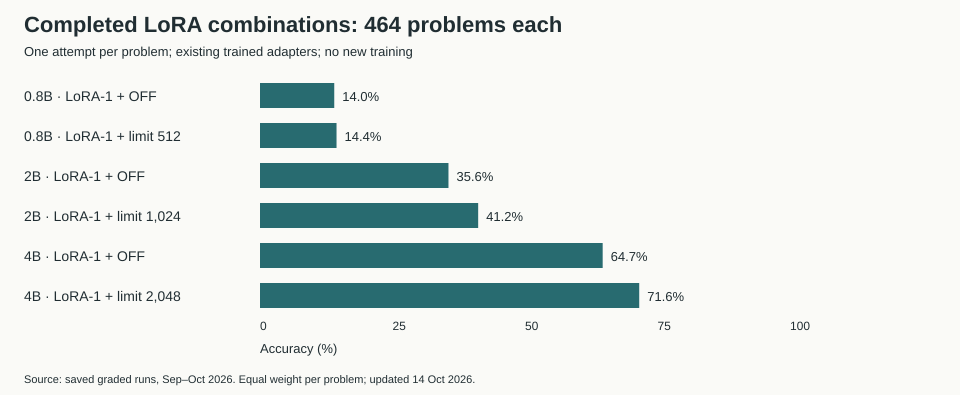
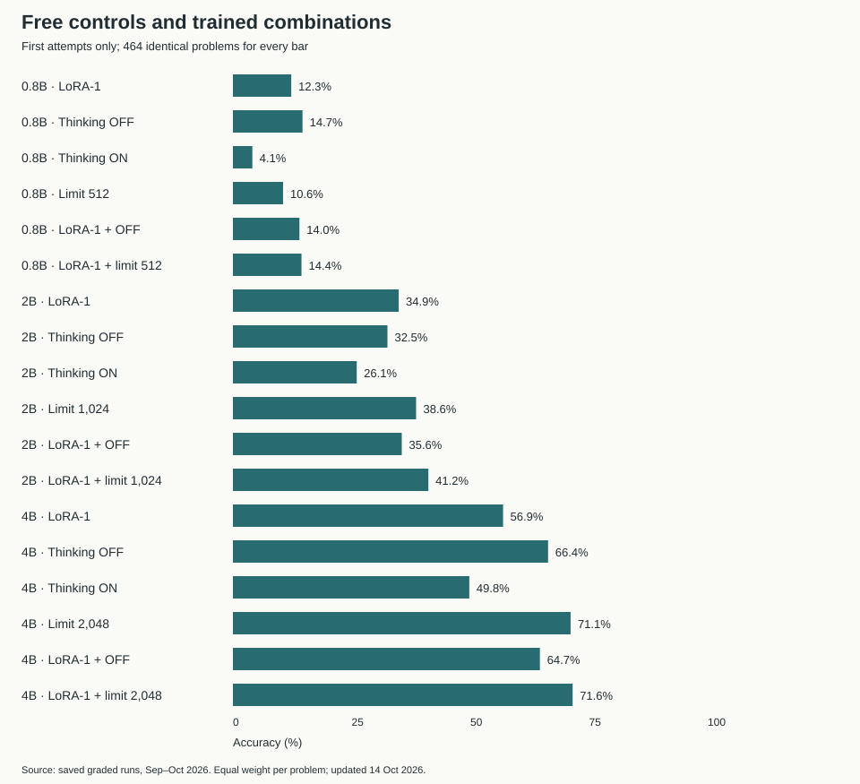

# The combined results

<!-- CURRENT-STUDY:START -->

**Current study — 14 October 2026:** **464 unique test problems**.
Benchmarks: **164 HumanEval+**, **166 LiveCodeBench easy**, **134 LiveCodeBench medium**.
All six planned LoRA combinations are complete, one attempt per problem:

- **0.8B:** LoRA + OFF **14.0% (65/464)**; LoRA + limit 512 **14.4% (67/464)**.
- **2B:** LoRA + OFF **35.6% (165/464)**; LoRA + limit 1,024 **41.2% (191/464)**.
- **4B:** LoRA + OFF **64.7% (300/464)**; LoRA + limit 2,048 **71.6% (332/464)**.

LoRA alone means thinking ON without a thinking-token limit.
Older methods' all-attempt averages and first-attempt comparisons are labelled separately.
LoRA + OFF does not consistently improve on free OFF; the 2B/4B gains over free limits remain uncertain.

[Every method, benchmark, difficulty, token count and interval](../results/CURRENT-RESULTS.md) · [Full easy thesis](../easy-thesis/FULL-THESIS.md) · [Full formal Markdown thesis](THESIS.md).

<!-- CURRENT-STUDY:END -->

**464 unique problems** form the main results view.
Accuracy gives each problem equal weight, using all its available attempts.

**0.8B: Thinking OFF 14.7%** · **2B: Limit 1,024 38.6%** · **4B: Limit 2,048 71.9%**

These are the best observed free controls among methods covering the full set.
The completed trained combinations are also included below.
A higher score on an incomplete subset does not establish a better method.

## Methods with complete coverage

| Model | Way | Accuracy | 95% interval | Coverage | Attempts |
|---|---|---|---|---|---|
| 0.8B | Limit 512 | 10.6% | [7.8%, 13.6%] | 464/464 | 464 |
| 0.8B | LoRA-1 | 12.3% | [9.3%, 15.3%] | 464/464 | 464 |
| 0.8B | LoRA-1 + limit 512 | 14.4% | [11.2%, 17.5%] | 464/464 | 464 |
| 0.8B | LoRA-1 + OFF | 14.0% | [11.0%, 17.0%] | 464/464 | 464 |
| 0.8B | Thinking OFF | 14.7% | [11.6%, 17.9%] | 464/464 | 464 |
| 0.8B | Thinking ON | 4.1% | [2.4%, 6.0%] | 464/464 | 464 |
| 2B | Limit 1,024 | 38.6% | [34.4%, 42.8%] | 464/464 | 738 |
| 2B | LoRA-1 | 34.4% | [30.3%, 38.4%] | 464/464 | 698 |
| 2B | LoRA-1 + limit 1,024 | 41.2% | [36.6%, 45.7%] | 464/464 | 464 |
| 2B | LoRA-1 + OFF | 35.6% | [31.2%, 39.7%] | 464/464 | 464 |
| 2B | Thinking OFF | 31.8% | [27.7%, 36.0%] | 464/464 | 738 |
| 2B | Thinking ON | 26.8% | [23.2%, 30.6%] | 464/464 | 738 |
| 4B | Limit 2,048 | 71.9% | [67.9%, 75.6%] | 464/464 | 738 |
| 4B | LoRA-1 | 56.8% | [52.5%, 61.0%] | 464/464 | 698 |
| 4B | LoRA-1 + limit 2,048 | 71.6% | [67.5%, 75.6%] | 464/464 | 464 |
| 4B | LoRA-1 + OFF | 64.7% | [59.9%, 69.0%] | 464/464 | 464 |
| 4B | Thinking OFF | 66.5% | [62.3%, 70.5%] | 464/464 | 738 |
| 4B | Thinking ON | 50.0% | [45.9%, 54.3%] | 464/464 | 738 |

## Training versus free controls on shared problems

| Model | Free control | Shared problems | Free accuracy | LoRA-1 accuracy | Gap (points) | 95% gap interval |
|---|---|---|---|---|---|---|
| 0.8B | Thinking OFF | 464 | 14.7% | 12.3% | +2.4 | [-0.4, +5.2] |
| 2B | Limit 1,024 | 464 | 38.6% | 34.4% | +4.2 | [+0.8, +7.8] |
| 4B | Limit 2,048 | 464 | 71.9% | 56.8% | +15.1 | [+11.3, +19.0] |

The 0.8B free control's lead is uncertain: its interval includes zero.
The 2B interval is narrowly positive, and the 4B interval is positive.
These intervals are descriptive and unadjusted for selecting comparisons after results.
Do not describe these as universal or definitive wins.

## All available methods, with coverage

Coverage means unique problems with results. A missing result is not counted as a failure. Only compare scores directly when they use the same problems.

| Model | Way | Accuracy | Coverage | Attempts |
|---|---|---|---|---|
| 0.8B | Limit 1,024 | 11.3% | 274/464 | 274 |
| 0.8B | Limit 512 | 10.6% | 464/464 | 464 |
| 0.8B | LoRA-1 | 12.3% | 464/464 | 464 |
| 0.8B | LoRA-1 + limit 512 | 14.4% | 464/464 | 464 |
| 0.8B | LoRA-1 + OFF | 14.0% | 464/464 | 464 |
| 0.8B | Thinking OFF | 14.7% | 464/464 | 464 |
| 0.8B | Thinking ON | 4.1% | 464/464 | 464 |
| 2B | Think briefly | 6.4% | 274/464 | 548 |
| 2B | Limit 1,024 | 38.6% | 464/464 | 738 |
| 2B | Limit 2,048 | 40.9% | 274/464 | 274 |
| 2B | Limit 512 | 39.4% | 274/464 | 548 |
| 2B | LoRA-1 | 34.4% | 464/464 | 698 |
| 2B | LoRA-1 + limit 1,024 | 41.2% | 464/464 | 464 |
| 2B | LoRA-1 + OFF | 35.6% | 464/464 | 464 |
| 2B | LoRA-2 | 45.1% | 234/464 | 468 |
| 2B | Thinking OFF | 31.8% | 464/464 | 738 |
| 2B | Thinking ON | 26.8% | 464/464 | 738 |
| 4B | Limit 1,024 | 76.5% | 234/464 | 468 |
| 4B | Limit 2,048 | 71.9% | 464/464 | 738 |
| 4B | Limit 4,096 | 76.7% | 234/464 | 468 |
| 4B | Limit 512 | 75.4% | 234/464 | 468 |
| 4B | LoRA-1 | 56.8% | 464/464 | 698 |
| 4B | LoRA-1 + limit 2,048 | 71.6% | 464/464 | 464 |
| 4B | LoRA-1 + OFF | 64.7% | 464/464 | 464 |
| 4B | Thinking OFF | 66.5% | 464/464 | 738 |
| 4B | Thinking ON | 50.0% | 464/464 | 738 |

For example, 2B Limit 2,048 covers only 274 problems.
Its score cannot be ranked directly against Limit 1,024 on 464 problems.
LoRA-2 covers only its original 234 problems; it is not a full-study result.

## Paired comparisons

Positive gaps favor the first method. Every row uses identical shared problem IDs.

| Model | Way vs reference | Shared problems | Way accuracy | Reference accuracy | Gap (points) | 95% gap interval |
|---|---|---|---|---|---|---|
| 0.8B | Thinking OFF vs Thinking ON | 464 | 14.7% | 4.1% | +10.6 | [+7.5, +13.8] |
| 0.8B | Thinking OFF vs LoRA-1 | 464 | 14.7% | 12.3% | +2.4 | [-0.4, +5.2] |
| 2B | Limit 1,024 vs Thinking ON | 464 | 38.6% | 26.8% | +11.7 | [+8.5, +15.1] |
| 2B | Limit 1,024 vs LoRA-1 | 464 | 38.6% | 34.4% | +4.2 | [+0.8, +7.8] |
| 2B | Limit 1,024 vs Thinking OFF | 464 | 38.6% | 31.8% | +6.8 | [+3.2, +10.5] |
| 4B | Limit 2,048 vs Thinking ON | 464 | 71.9% | 50.0% | +21.9 | [+18.3, +25.5] |
| 4B | Limit 2,048 vs LoRA-1 | 464 | 71.9% | 56.8% | +15.1 | [+11.3, +19.0] |
| 4B | Limit 2,048 vs Thinking OFF | 464 | 71.9% | 66.5% | +5.4 | [+1.6, +9.1] |
| 0.8B | LoRA-1 + limit 512 vs Limit 512 | 464 | 14.4% | 10.6% | +3.9 | [+0.6, +7.1] |
| 0.8B | LoRA-1 + limit 512 vs LoRA-1 | 464 | 14.4% | 12.3% | +2.2 | [-0.4, +5.0] |
| 0.8B | LoRA-1 + limit 512 vs Thinking OFF | 464 | 14.4% | 14.7% | -0.2 | [-3.0, +3.0] |
| 0.8B | LoRA-1 + OFF vs Thinking OFF | 464 | 14.0% | 14.7% | -0.6 | [-3.2, +2.2] |
| 0.8B | LoRA-1 + OFF vs LoRA-1 | 464 | 14.0% | 12.3% | +1.7 | [-0.9, +4.5] |
| 2B | LoRA-1 + limit 1,024 vs Limit 1,024 | 464 | 41.2% | 38.6% | +2.6 | [-1.4, +6.5] |
| 2B | LoRA-1 + limit 1,024 vs LoRA-1 | 464 | 41.2% | 34.4% | +6.8 | [+2.9, +10.7] |
| 2B | LoRA-1 + limit 1,024 vs Thinking OFF | 464 | 41.2% | 31.8% | +9.4 | [+5.4, +13.5] |
| 2B | LoRA-1 + OFF vs Thinking OFF | 464 | 35.6% | 31.8% | +3.8 | [+0.2, +7.3] |
| 2B | LoRA-1 + OFF vs LoRA-1 | 464 | 35.6% | 34.4% | +1.2 | [-2.6, +5.1] |
| 4B | LoRA-1 + limit 2,048 vs Limit 2,048 | 464 | 71.6% | 71.9% | -0.3 | [-3.7, +2.8] |
| 4B | LoRA-1 + limit 2,048 vs LoRA-1 | 464 | 71.6% | 56.8% | +14.8 | [+10.8, +19.0] |
| 4B | LoRA-1 + limit 2,048 vs Thinking OFF | 464 | 71.6% | 66.5% | +5.1 | [+0.9, +9.2] |
| 4B | LoRA-1 + OFF vs Thinking OFF | 464 | 64.7% | 66.5% | -1.8 | [-5.4, +1.6] |
| 4B | LoRA-1 + OFF vs LoRA-1 | 464 | 64.7% | 56.8% | +7.9 | [+3.6, +12.2] |

## Tokens and output caps

A token is a small piece of text. These are averages of per-problem means.
All tokens include both thinking and the final answer.
“Hit output cap” comes from the saved flag; it is not a loop detector or the pass/fail rule.
Token counts describe output length, not measured GPU time.

| Model | Way | Coverage | Thinking tokens | All tokens | Hit output cap |
|---|---|---|---|---|---|
| 0.8B | Limit 1,024 | 274/464 | 975 | 4,794 | 72.3% |
| 0.8B | Limit 512 | 464/464 | 510 | 5,920 | 80.2% |
| 0.8B | LoRA-1 | 464/464 | 5,150 | 5,256 | 68.1% |
| 0.8B | LoRA-1 + limit 512 | 464/464 | 503 | 4,979 | 61.6% |
| 0.8B | LoRA-1 + OFF | 464/464 | 0 | 1,278 | 13.6% |
| 0.8B | Thinking OFF | 464/464 | 0 | 1,781 | 19.0% |
| 0.8B | Thinking ON | 464/464 | 6,147 | 6,206 | 86.4% |
| 2B | Think briefly | 274/464 | 5,484 | 5,507 | 92.3% |
| 2B | Limit 1,024 | 464/464 | 923 | 4,337 | 45.3% |
| 2B | Limit 2,048 | 274/464 | 1,453 | 1,978 | 37.6% |
| 2B | Limit 512 | 274/464 | 495 | 3,388 | 37.2% |
| 2B | LoRA-1 | 464/464 | 4,414 | 4,735 | 52.6% |
| 2B | LoRA-1 + limit 1,024 | 464/464 | 892 | 4,072 | 40.5% |
| 2B | LoRA-1 + OFF | 464/464 | 0 | 1,445 | 14.4% |
| 2B | LoRA-2 | 234/464 | 3,252 | 3,392 | 41.0% |
| 2B | Thinking OFF | 464/464 | 0 | 1,337 | 12.4% |
| 2B | Thinking ON | 464/464 | 5,169 | 5,331 | 60.6% |
| 4B | Limit 1,024 | 234/464 | 763 | 2,185 | 16.7% |
| 4B | Limit 2,048 | 464/464 | 1,603 | 3,921 | 29.2% |
| 4B | Limit 4,096 | 234/464 | 1,915 | 2,821 | 16.7% |
| 4B | Limit 512 | 234/464 | 481 | 2,168 | 17.1% |
| 4B | LoRA-1 | 464/464 | 4,661 | 4,797 | 38.5% |
| 4B | LoRA-1 + limit 2,048 | 464/464 | 1,512 | 3,511 | 23.1% |
| 4B | LoRA-1 + OFF | 464/464 | 0 | 882 | 5.6% |
| 4B | Thinking OFF | 464/464 | 0 | 943 | 5.3% |
| 4B | Thinking ON | 464/464 | 5,064 | 5,188 | 45.7% |

## Selected free controls by problem group

| Model | Way | Problem group | Coverage | Accuracy |
|---|---|---|---|---|
| 0.8B | Thinking OFF | HumanEval+ easy | 164 | 25.6% |
| 0.8B | Thinking OFF | LiveCodeBench easy | 166 | 15.7% |
| 0.8B | Thinking OFF | LiveCodeBench medium | 134 | 0.0% |
| 2B | Limit 1,024 | HumanEval+ easy | 164 | 60.4% |
| 2B | Limit 1,024 | LiveCodeBench easy | 166 | 43.4% |
| 2B | Limit 1,024 | LiveCodeBench medium | 134 | 6.0% |
| 4B | Limit 2,048 | HumanEval+ easy | 164 | 86.9% |
| 4B | Limit 2,048 | LiveCodeBench easy | 166 | 85.2% |
| 4B | Limit 2,048 | LiveCodeBench medium | 134 | 36.9% |

Different difficulty mixes change the overall score. Report these groups alongside the headline.

## Earlier focused checks

LoRA-2's original 234-problem experiment reported a thinking-length ratio of x1.00
and 45.1% accuracy. These were not rerun on all 464 problems.
The earlier MBPP+ pilot used 100 separate test problems. It is excluded here.
Its 65% LoRA accuracy versus 50% thinking ON is an earlier transfer check, not a combined score.
Loop and longer-output checks retain their original coverage in [the explanation](../easy-thesis/06-why-it-works.md).

Source: [combined results](../results/combined/README.md), calculated from saved graded answers. No model was run again.

## Completed LoRA combinations

| Model | Combination | Passed | Coverage | Accuracy | 95% interval | Mean total tokens |
|---|---|---|---|---|---|---|
| 0.8B | LoRA-1 + OFF | 65 | 464/464 | 14.0% | [11.0%, 17.0%] | 1,278 |
| 0.8B | LoRA-1 + limit 512 | 67 | 464/464 | 14.4% | [11.2%, 17.5%] | 4,979 |
| 2B | LoRA-1 + OFF | 165 | 464/464 | 35.6% | [31.2%, 39.7%] | 1,445 |
| 2B | LoRA-1 + limit 1,024 | 191 | 464/464 | 41.2% | [36.6%, 45.7%] | 4,072 |
| 4B | LoRA-1 + OFF | 300 | 464/464 | 64.7% | [59.9%, 69.0%] | 882 |
| 4B | LoRA-1 + limit 2,048 | 332 | 464/464 | 71.6% | [67.5%, 75.6%] | 3,511 |

## Same 464 problems, first attempts only

Older methods can have two attempts per problem. For this comparison we use
only their first saved attempts, matching the new runs' single attempt.
This explains 2B LoRA alone: **34.9% first attempts versus 34.4% all attempts**.
Likewise, 4B limit alone is **71.1% first attempts versus 71.9% all attempts**.
These are two calculations from the same saved results, not contradictory scores.

| Model | Way | Passed / tested | First-attempt accuracy | Mean total tokens |
|---|---|---|---|---|
| 0.8B | LoRA-1 | 57/464 | 12.3% | 5,256 |
| 0.8B | Thinking OFF | 68/464 | 14.7% | 1,781 |
| 0.8B | Thinking ON | 19/464 | 4.1% | 6,206 |
| 0.8B | Limit 512 | 49/464 | 10.6% | 5,920 |
| 0.8B | LoRA-1 + OFF | 65/464 | 14.0% | 1,278 |
| 0.8B | LoRA-1 + limit 512 | 67/464 | 14.4% | 4,979 |
| 2B | LoRA-1 | 162/464 | 34.9% | 4,701 |
| 2B | Thinking OFF | 151/464 | 32.5% | 1,366 |
| 2B | Thinking ON | 121/464 | 26.1% | 5,369 |
| 2B | Limit 1,024 | 179/464 | 38.6% | 4,348 |
| 2B | LoRA-1 + OFF | 165/464 | 35.6% | 1,445 |
| 2B | LoRA-1 + limit 1,024 | 191/464 | 41.2% | 4,072 |
| 4B | LoRA-1 | 264/464 | 56.9% | 4,779 |
| 4B | Thinking OFF | 308/464 | 66.4% | 941 |
| 4B | Thinking ON | 231/464 | 49.8% | 5,186 |
| 4B | Limit 2,048 | 330/464 | 71.1% | 3,965 |
| 4B | LoRA-1 + OFF | 300/464 | 64.7% | 882 |
| 4B | LoRA-1 + limit 2,048 | 332/464 | 71.6% | 3,511 |

| Model | First-attempt comparison | Shared problems | Gap (points) | 95% gap interval |
|---|---|---|---|---|
| 0.8B | LoRA-1 + OFF vs Thinking OFF | 464 | -0.6 | [-3.2, +2.2] |
| 0.8B | LoRA-1 + OFF vs LoRA-1 | 464 | +1.7 | [-0.9, +4.5] |
| 0.8B | LoRA-1 + limit 512 vs Limit 512 | 464 | +3.9 | [+0.6, +7.1] |
| 0.8B | LoRA-1 + limit 512 vs LoRA-1 | 464 | +2.2 | [-0.4, +5.0] |
| 0.8B | LoRA-1 + limit 512 vs Thinking OFF | 464 | -0.2 | [-3.0, +3.0] |
| 2B | LoRA-1 + OFF vs Thinking OFF | 464 | +3.0 | [-0.6, +6.9] |
| 2B | LoRA-1 + OFF vs LoRA-1 | 464 | +0.6 | [-3.4, +4.7] |
| 2B | LoRA-1 + limit 1,024 vs Limit 1,024 | 464 | +2.6 | [-1.5, +6.7] |
| 2B | LoRA-1 + limit 1,024 vs LoRA-1 | 464 | +6.2 | [+2.4, +10.1] |
| 2B | LoRA-1 + limit 1,024 vs Thinking OFF | 464 | +8.6 | [+4.5, +12.9] |
| 4B | LoRA-1 + OFF vs Thinking OFF | 464 | -1.7 | [-5.6, +1.9] |
| 4B | LoRA-1 + OFF vs LoRA-1 | 464 | +7.8 | [+3.2, +12.1] |
| 4B | LoRA-1 + limit 2,048 vs Limit 2,048 | 464 | +0.4 | [-3.0, +3.7] |
| 4B | LoRA-1 + limit 2,048 vs LoRA-1 | 464 | +14.7 | [+10.3, +19.0] |
| 4B | LoRA-1 + limit 2,048 vs Thinking OFF | 464 | +5.2 | [+0.6, +9.5] |
| 0.8B | LoRA-1 + limit 512 vs LoRA-1 + OFF | 464 | +0.4 | [-2.4, +3.2] |
| 2B | LoRA-1 + limit 1,024 vs LoRA-1 + OFF | 464 | +5.6 | [+1.1, +9.9] |
| 4B | LoRA-1 + limit 2,048 vs LoRA-1 + OFF | 464 | +6.9 | [+2.8, +11.2] |

### What the completed tests show

- **0.8B:** LoRA + OFF passes 65/464 (14.0%); LoRA + limit 512 passes 67/464 (14.4%).
  OFF without LoRA passes 68/464 (14.7%). There is no clear gain over OFF.
  LoRA + limit improves on the matching free limit by 3.9 points, interval +0.6 to +7.1.
- **2B:** LoRA + OFF passes 165/464 (35.6%); LoRA + limit 1,024 passes 191/464 (41.2%).
  The limit combination beats LoRA + OFF by 5.6 points, interval +1.1 to +9.9.
  Its 2.6-point gain over limit alone remains uncertain, interval −1.5 to +6.7.
- **4B:** LoRA + OFF passes 300/464 (64.7%); LoRA + limit 2,048 passes 332/464 (71.6%).
  Limit alone passes 330/464 (71.1%). The two-pass gain is inconclusive,
  interval −3.0 to +3.7 points. The combination uses about 11.4% fewer output tokens.

These are same-problem, first-attempt comparisons with historical references.
Intervals are unadjusted for multiple comparisons. They are not proof of universal wins.
Shorter output does not directly establish lower GPU time, energy, or money.

## Every benchmark and difficulty: all available methods

Each row averages attempts within a problem, then gives every problem equal weight.
Denominators are shown. Incomplete methods must not be ranked against full coverage.

| Model | Way | Benchmark | Difficulty | Problems tested | Accuracy (all attempts, equal problem weight) |
|---|---|---|---|---|---|
| 0.8B | Limit 1,024 | HumanEval+ | easy | 164 | 17.1% |
| 0.8B | Limit 1,024 | LiveCodeBench | all | 110 | 2.7% |
| 0.8B | Limit 1,024 | LiveCodeBench | easy | 48 | 6.2% |
| 0.8B | Limit 1,024 | LiveCodeBench | medium | 62 | 0.0% |
| 0.8B | Limit 512 | HumanEval+ | easy | 164 | 22.6% |
| 0.8B | Limit 512 | LiveCodeBench | all | 300 | 4.0% |
| 0.8B | Limit 512 | LiveCodeBench | easy | 166 | 6.6% |
| 0.8B | Limit 512 | LiveCodeBench | medium | 134 | 0.7% |
| 0.8B | LoRA-1 | HumanEval+ | easy | 164 | 22.0% |
| 0.8B | LoRA-1 | LiveCodeBench | all | 300 | 7.0% |
| 0.8B | LoRA-1 | LiveCodeBench | easy | 166 | 12.0% |
| 0.8B | LoRA-1 | LiveCodeBench | medium | 134 | 0.7% |
| 0.8B | LoRA-1 + limit 512 | HumanEval+ | easy | 164 | 26.8% |
| 0.8B | LoRA-1 + limit 512 | LiveCodeBench | all | 300 | 7.7% |
| 0.8B | LoRA-1 + limit 512 | LiveCodeBench | easy | 166 | 12.7% |
| 0.8B | LoRA-1 + limit 512 | LiveCodeBench | medium | 134 | 1.5% |
| 0.8B | LoRA-1 + OFF | HumanEval+ | easy | 164 | 25.0% |
| 0.8B | LoRA-1 + OFF | LiveCodeBench | all | 300 | 8.0% |
| 0.8B | LoRA-1 + OFF | LiveCodeBench | easy | 166 | 13.9% |
| 0.8B | LoRA-1 + OFF | LiveCodeBench | medium | 134 | 0.7% |
| 0.8B | Thinking OFF | HumanEval+ | easy | 164 | 25.6% |
| 0.8B | Thinking OFF | LiveCodeBench | all | 300 | 8.7% |
| 0.8B | Thinking OFF | LiveCodeBench | easy | 166 | 15.7% |
| 0.8B | Thinking OFF | LiveCodeBench | medium | 134 | 0.0% |
| 0.8B | Thinking ON | HumanEval+ | easy | 164 | 10.4% |
| 0.8B | Thinking ON | LiveCodeBench | all | 300 | 0.7% |
| 0.8B | Thinking ON | LiveCodeBench | easy | 166 | 0.6% |
| 0.8B | Thinking ON | LiveCodeBench | medium | 134 | 0.7% |
| 2B | Think briefly | HumanEval+ | easy | 164 | 3.7% |
| 2B | Think briefly | LiveCodeBench | all | 110 | 10.5% |
| 2B | Think briefly | LiveCodeBench | easy | 48 | 24.0% |
| 2B | Think briefly | LiveCodeBench | medium | 62 | 0.0% |
| 2B | Limit 1,024 | HumanEval+ | easy | 164 | 60.4% |
| 2B | Limit 1,024 | LiveCodeBench | all | 300 | 26.7% |
| 2B | Limit 1,024 | LiveCodeBench | easy | 166 | 43.4% |
| 2B | Limit 1,024 | LiveCodeBench | medium | 134 | 6.0% |
| 2B | Limit 2,048 | HumanEval+ | easy | 164 | 57.3% |
| 2B | Limit 2,048 | LiveCodeBench | all | 110 | 16.4% |
| 2B | Limit 2,048 | LiveCodeBench | easy | 48 | 37.5% |
| 2B | Limit 2,048 | LiveCodeBench | medium | 62 | 0.0% |
| 2B | Limit 512 | HumanEval+ | easy | 164 | 54.9% |
| 2B | Limit 512 | LiveCodeBench | all | 110 | 16.4% |
| 2B | Limit 512 | LiveCodeBench | easy | 48 | 33.3% |
| 2B | Limit 512 | LiveCodeBench | medium | 62 | 3.2% |
| 2B | LoRA-1 | HumanEval+ | easy | 164 | 56.4% |
| 2B | LoRA-1 | LiveCodeBench | all | 300 | 22.3% |
| 2B | LoRA-1 | LiveCodeBench | easy | 166 | 38.6% |
| 2B | LoRA-1 | LiveCodeBench | medium | 134 | 2.2% |
| 2B | LoRA-1 + limit 1,024 | HumanEval+ | easy | 164 | 60.4% |
| 2B | LoRA-1 + limit 1,024 | LiveCodeBench | all | 300 | 30.7% |
| 2B | LoRA-1 + limit 1,024 | LiveCodeBench | easy | 166 | 49.4% |
| 2B | LoRA-1 + limit 1,024 | LiveCodeBench | medium | 134 | 7.5% |
| 2B | LoRA-1 + OFF | HumanEval+ | easy | 164 | 51.2% |
| 2B | LoRA-1 + OFF | LiveCodeBench | all | 300 | 27.0% |
| 2B | LoRA-1 + OFF | LiveCodeBench | easy | 166 | 45.2% |
| 2B | LoRA-1 + OFF | LiveCodeBench | medium | 134 | 4.5% |
| 2B | LoRA-2 | HumanEval+ | easy | 164 | 56.4% |
| 2B | LoRA-2 | LiveCodeBench | all | 70 | 18.6% |
| 2B | LoRA-2 | LiveCodeBench | easy | 31 | 38.7% |
| 2B | LoRA-2 | LiveCodeBench | medium | 39 | 2.6% |
| 2B | Thinking OFF | HumanEval+ | easy | 164 | 47.3% |
| 2B | Thinking OFF | LiveCodeBench | all | 300 | 23.3% |
| 2B | Thinking OFF | LiveCodeBench | easy | 166 | 38.0% |
| 2B | Thinking OFF | LiveCodeBench | medium | 134 | 5.2% |
| 2B | Thinking ON | HumanEval+ | easy | 164 | 55.2% |
| 2B | Thinking ON | LiveCodeBench | all | 300 | 11.3% |
| 2B | Thinking ON | LiveCodeBench | easy | 166 | 18.4% |
| 2B | Thinking ON | LiveCodeBench | medium | 134 | 2.6% |
| 4B | Limit 1,024 | HumanEval+ | easy | 164 | 85.1% |
| 4B | Limit 1,024 | LiveCodeBench | all | 70 | 56.4% |
| 4B | Limit 1,024 | LiveCodeBench | easy | 31 | 82.3% |
| 4B | Limit 1,024 | LiveCodeBench | medium | 39 | 35.9% |
| 4B | Limit 2,048 | HumanEval+ | easy | 164 | 86.9% |
| 4B | Limit 2,048 | LiveCodeBench | all | 300 | 63.7% |
| 4B | Limit 2,048 | LiveCodeBench | easy | 166 | 85.2% |
| 4B | Limit 2,048 | LiveCodeBench | medium | 134 | 36.9% |
| 4B | Limit 4,096 | HumanEval+ | easy | 164 | 86.9% |
| 4B | Limit 4,096 | LiveCodeBench | all | 70 | 52.9% |
| 4B | Limit 4,096 | LiveCodeBench | easy | 31 | 79.0% |
| 4B | Limit 4,096 | LiveCodeBench | medium | 39 | 32.1% |
| 4B | Limit 512 | HumanEval+ | easy | 164 | 84.1% |
| 4B | Limit 512 | LiveCodeBench | all | 70 | 55.0% |
| 4B | Limit 512 | LiveCodeBench | easy | 31 | 83.9% |
| 4B | Limit 512 | LiveCodeBench | medium | 39 | 32.1% |
| 4B | LoRA-1 | HumanEval+ | easy | 164 | 85.1% |
| 4B | LoRA-1 | LiveCodeBench | all | 300 | 41.3% |
| 4B | LoRA-1 | LiveCodeBench | easy | 166 | 67.5% |
| 4B | LoRA-1 | LiveCodeBench | medium | 134 | 9.0% |
| 4B | LoRA-1 + limit 2,048 | HumanEval+ | easy | 164 | 84.1% |
| 4B | LoRA-1 + limit 2,048 | LiveCodeBench | all | 300 | 64.7% |
| 4B | LoRA-1 + limit 2,048 | LiveCodeBench | easy | 166 | 86.1% |
| 4B | LoRA-1 + limit 2,048 | LiveCodeBench | medium | 134 | 38.1% |
| 4B | LoRA-1 + OFF | HumanEval+ | easy | 164 | 79.3% |
| 4B | LoRA-1 + OFF | LiveCodeBench | all | 300 | 56.7% |
| 4B | LoRA-1 + OFF | LiveCodeBench | easy | 166 | 74.7% |
| 4B | LoRA-1 + OFF | LiveCodeBench | medium | 134 | 34.3% |
| 4B | Thinking OFF | HumanEval+ | easy | 164 | 78.7% |
| 4B | Thinking OFF | LiveCodeBench | all | 300 | 59.8% |
| 4B | Thinking OFF | LiveCodeBench | easy | 166 | 79.5% |
| 4B | Thinking OFF | LiveCodeBench | medium | 134 | 35.4% |
| 4B | Thinking ON | HumanEval+ | easy | 164 | 80.5% |
| 4B | Thinking ON | LiveCodeBench | all | 300 | 33.3% |
| 4B | Thinking ON | LiveCodeBench | easy | 166 | 56.6% |
| 4B | Thinking ON | LiveCodeBench | medium | 134 | 4.5% |

## Every benchmark and difficulty: first attempts

Every method below has all 464 test IDs: 164 HumanEval+, 166 LiveCodeBench easy,
and 134 LiveCodeBench medium. Counts show successes, not coverage alone.

| Model | Way | Benchmark | Difficulty | Passed / tested | First-attempt accuracy |
|---|---|---|---|---|---|
| 0.8B | LoRA-1 | HumanEval+ | easy | 36/164 | 22.0% |
| 0.8B | LoRA-1 | LiveCodeBench | all | 21/300 | 7.0% |
| 0.8B | LoRA-1 | LiveCodeBench | easy | 20/166 | 12.0% |
| 0.8B | LoRA-1 | LiveCodeBench | medium | 1/134 | 0.7% |
| 0.8B | Thinking OFF | HumanEval+ | easy | 42/164 | 25.6% |
| 0.8B | Thinking OFF | LiveCodeBench | all | 26/300 | 8.7% |
| 0.8B | Thinking OFF | LiveCodeBench | easy | 26/166 | 15.7% |
| 0.8B | Thinking OFF | LiveCodeBench | medium | 0/134 | 0.0% |
| 0.8B | Thinking ON | HumanEval+ | easy | 17/164 | 10.4% |
| 0.8B | Thinking ON | LiveCodeBench | all | 2/300 | 0.7% |
| 0.8B | Thinking ON | LiveCodeBench | easy | 1/166 | 0.6% |
| 0.8B | Thinking ON | LiveCodeBench | medium | 1/134 | 0.7% |
| 0.8B | Limit 512 | HumanEval+ | easy | 37/164 | 22.6% |
| 0.8B | Limit 512 | LiveCodeBench | all | 12/300 | 4.0% |
| 0.8B | Limit 512 | LiveCodeBench | easy | 11/166 | 6.6% |
| 0.8B | Limit 512 | LiveCodeBench | medium | 1/134 | 0.7% |
| 0.8B | LoRA-1 + OFF | HumanEval+ | easy | 41/164 | 25.0% |
| 0.8B | LoRA-1 + OFF | LiveCodeBench | all | 24/300 | 8.0% |
| 0.8B | LoRA-1 + OFF | LiveCodeBench | easy | 23/166 | 13.9% |
| 0.8B | LoRA-1 + OFF | LiveCodeBench | medium | 1/134 | 0.7% |
| 0.8B | LoRA-1 + limit 512 | HumanEval+ | easy | 44/164 | 26.8% |
| 0.8B | LoRA-1 + limit 512 | LiveCodeBench | all | 23/300 | 7.7% |
| 0.8B | LoRA-1 + limit 512 | LiveCodeBench | easy | 21/166 | 12.7% |
| 0.8B | LoRA-1 + limit 512 | LiveCodeBench | medium | 2/134 | 1.5% |
| 2B | LoRA-1 | HumanEval+ | easy | 95/164 | 57.9% |
| 2B | LoRA-1 | LiveCodeBench | all | 67/300 | 22.3% |
| 2B | LoRA-1 | LiveCodeBench | easy | 63/166 | 38.0% |
| 2B | LoRA-1 | LiveCodeBench | medium | 4/134 | 3.0% |
| 2B | Thinking OFF | HumanEval+ | easy | 79/164 | 48.2% |
| 2B | Thinking OFF | LiveCodeBench | all | 72/300 | 24.0% |
| 2B | Thinking OFF | LiveCodeBench | easy | 63/166 | 38.0% |
| 2B | Thinking OFF | LiveCodeBench | medium | 9/134 | 6.7% |
| 2B | Thinking ON | HumanEval+ | easy | 88/164 | 53.7% |
| 2B | Thinking ON | LiveCodeBench | all | 33/300 | 11.0% |
| 2B | Thinking ON | LiveCodeBench | easy | 30/166 | 18.1% |
| 2B | Thinking ON | LiveCodeBench | medium | 3/134 | 2.2% |
| 2B | Limit 1,024 | HumanEval+ | easy | 99/164 | 60.4% |
| 2B | Limit 1,024 | LiveCodeBench | all | 80/300 | 26.7% |
| 2B | Limit 1,024 | LiveCodeBench | easy | 73/166 | 44.0% |
| 2B | Limit 1,024 | LiveCodeBench | medium | 7/134 | 5.2% |
| 2B | LoRA-1 + OFF | HumanEval+ | easy | 84/164 | 51.2% |
| 2B | LoRA-1 + OFF | LiveCodeBench | all | 81/300 | 27.0% |
| 2B | LoRA-1 + OFF | LiveCodeBench | easy | 75/166 | 45.2% |
| 2B | LoRA-1 + OFF | LiveCodeBench | medium | 6/134 | 4.5% |
| 2B | LoRA-1 + limit 1,024 | HumanEval+ | easy | 99/164 | 60.4% |
| 2B | LoRA-1 + limit 1,024 | LiveCodeBench | all | 92/300 | 30.7% |
| 2B | LoRA-1 + limit 1,024 | LiveCodeBench | easy | 82/166 | 49.4% |
| 2B | LoRA-1 + limit 1,024 | LiveCodeBench | medium | 10/134 | 7.5% |
| 4B | LoRA-1 | HumanEval+ | easy | 140/164 | 85.4% |
| 4B | LoRA-1 | LiveCodeBench | all | 124/300 | 41.3% |
| 4B | LoRA-1 | LiveCodeBench | easy | 112/166 | 67.5% |
| 4B | LoRA-1 | LiveCodeBench | medium | 12/134 | 9.0% |
| 4B | Thinking OFF | HumanEval+ | easy | 127/164 | 77.4% |
| 4B | Thinking OFF | LiveCodeBench | all | 181/300 | 60.3% |
| 4B | Thinking OFF | LiveCodeBench | easy | 134/166 | 80.7% |
| 4B | Thinking OFF | LiveCodeBench | medium | 47/134 | 35.1% |
| 4B | Thinking ON | HumanEval+ | easy | 132/164 | 80.5% |
| 4B | Thinking ON | LiveCodeBench | all | 99/300 | 33.0% |
| 4B | Thinking ON | LiveCodeBench | easy | 94/166 | 56.6% |
| 4B | Thinking ON | LiveCodeBench | medium | 5/134 | 3.7% |
| 4B | Limit 2,048 | HumanEval+ | easy | 141/164 | 86.0% |
| 4B | Limit 2,048 | LiveCodeBench | all | 189/300 | 63.0% |
| 4B | Limit 2,048 | LiveCodeBench | easy | 139/166 | 83.7% |
| 4B | Limit 2,048 | LiveCodeBench | medium | 50/134 | 37.3% |
| 4B | LoRA-1 + OFF | HumanEval+ | easy | 130/164 | 79.3% |
| 4B | LoRA-1 + OFF | LiveCodeBench | all | 170/300 | 56.7% |
| 4B | LoRA-1 + OFF | LiveCodeBench | easy | 124/166 | 74.7% |
| 4B | LoRA-1 + OFF | LiveCodeBench | medium | 46/134 | 34.3% |
| 4B | LoRA-1 + limit 2,048 | HumanEval+ | easy | 138/164 | 84.1% |
| 4B | LoRA-1 + limit 2,048 | LiveCodeBench | all | 194/300 | 64.7% |
| 4B | LoRA-1 + limit 2,048 | LiveCodeBench | easy | 143/166 | 86.1% |
| 4B | LoRA-1 + limit 2,048 | LiveCodeBench | medium | 51/134 | 38.1% |
